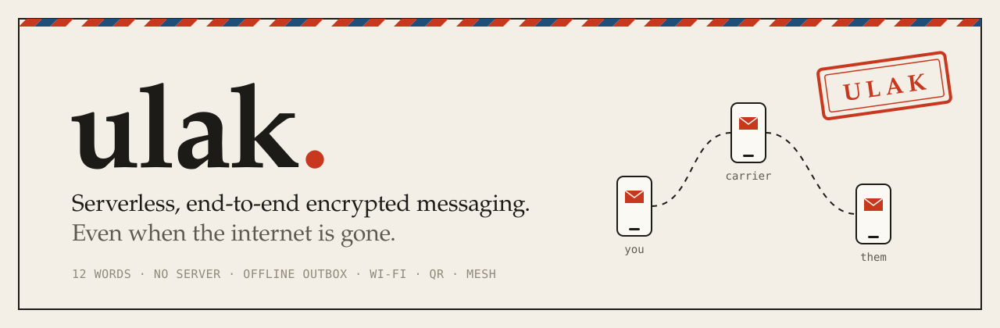
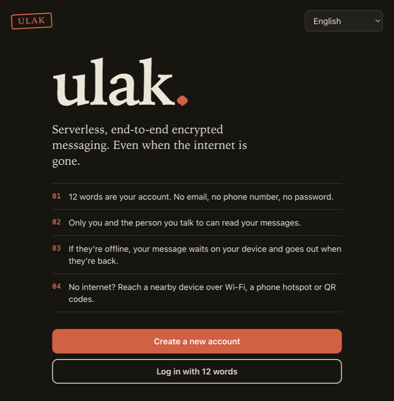
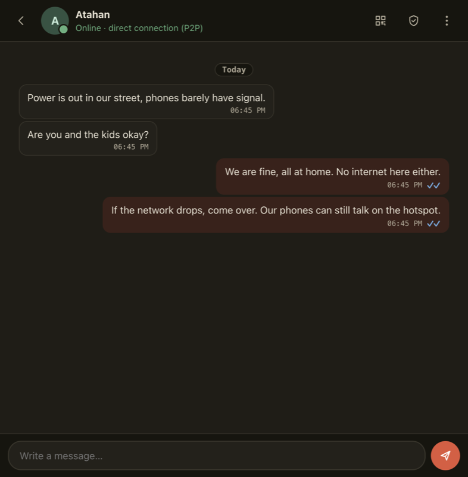
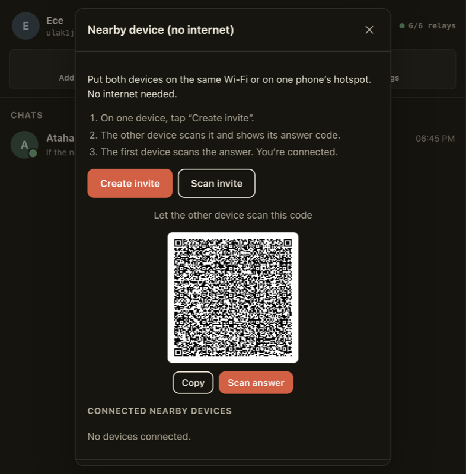
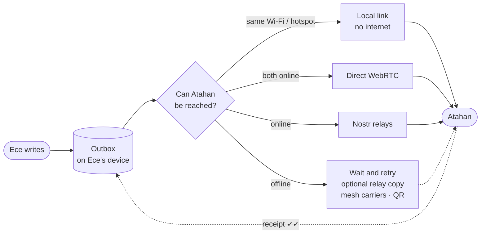
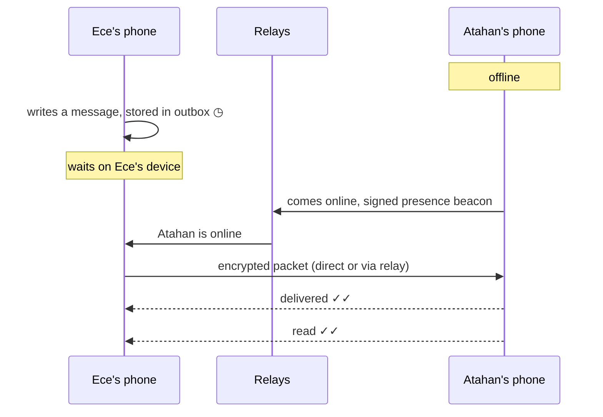
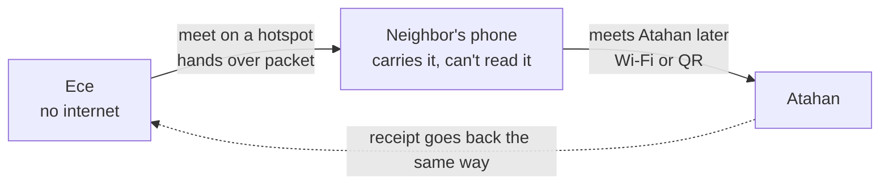
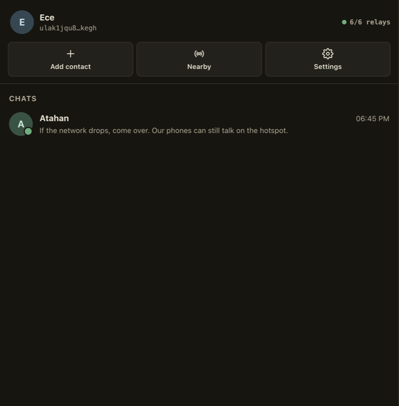
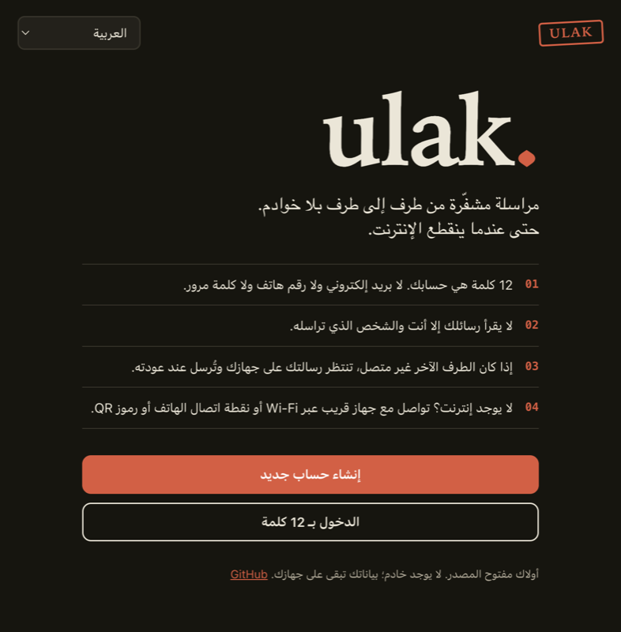

<p align="center">
  
</p>

<p align="center">
  <a href="LICENSE"></a>
  
  
  
  
</p>

<p align="center">
  <b>Your account is 12 words.</b> No phone number, no email, no password, no server that owns your data.<br>
  If they're offline, your message waits on your device and leaves the moment they're back.<br>
  If the internet is gone, phones on the same Wi-Fi or hotspot still talk, and messages can travel hand to hand.
</p>

<p align="center">
  
  &nbsp;
  
  &nbsp;
  
</p>

> *Ulak* is an old Turkish word for a courier who carried messages on foot or horseback.

This repository is **reference code, not a hosted service**. It runs as a static web app (PWA) with
zero dependencies and no build step, and the core is written so anyone can fork it into a mobile app,
a desktop app or their own deployment, and plug in new transports such as Bluetooth.

---

## Features

<table>
<tr>
<td width="50%" valign="top">

**12-word account**<br>
A standard BIP39 phrase is your identity. The same words open the same account on any device.

</td>
<td width="50%" valign="top">

**End-to-end encrypted**<br>
secp256k1 ECDH, HKDF-SHA256 and AES-256-GCM. Relays and carriers only see who-to-whom, never content.

</td>
</tr>
<tr>
<td valign="top">

**Offline outbox**<br>
Messages wait on the sender's device and go out automatically. Receipts: ◷ waiting, ✓ sent, ✓✓ delivered, blue ✓✓ read.

</td>
<td valign="top">

**Direct when possible**<br>
When both are online, ulak upgrades to a WebRTC data channel. Relays only help the two devices find each other.

</td>
</tr>
<tr>
<td valign="top">

**No internet, same network**<br>
Two devices on one router or one phone's hotspot connect by scanning each other's QR code. No internet, no server.

</td>
<td valign="top">

**No network at all**<br>
Undelivered messages can be shown as QR codes and scanned by the recipient's camera.

</td>
</tr>
<tr>
<td valign="top">

**Store-and-carry mesh**<br>
Phones can carry encrypted packets for others and hand them over when they meet the recipient. Built for earthquakes, floods and outages.

</td>
<td valign="top">

**10 languages**<br>
English, Türkçe, Español, Português, Русский, العربية, हिन्दी, 中文, 日本語, 한국어. Right-to-left layout included.

</td>
</tr>
</table>

---

## How a message finds its way

Every path carries the same encrypted packet. The message stays in the outbox until the recipient's
device confirms it, so closing the tab, switching networks or losing power never loses it.



### When the other side is offline



### When there is no internet at all

After an earthquake the cell network is down. Ece's message reaches Atahan through a neighbor's
phone that happens to meet both of them. The neighbor can't read it; it only sees two public keys.



Packets carry a hop budget (4 by default), so they spread a few phones far and then stop. Carried
packets expire after 7 days. Each user decides in settings whether their device carries for others.

---

## Run it

Requires Node.js 20 or newer. Nothing to install.

```sh
git clone https://github.com/erdinckaya97/ulak.git
cd ulak
npm start          # http://localhost:8080
npm test           # 32 unit and integration tests
```

Any static file server works. Anywhere other than `localhost`, serve it over **HTTPS**: the camera,
WebCrypto and the service worker all need a secure context.

**Try two accounts on one computer:** open `http://localhost:8080` and `http://127.0.0.1:8080`
(different origins keep separate storage), create an account in each and add one another by ID.

**Deploy:** copy the folder to any static host, such as GitHub Pages, Netlify, Cloudflare Pages, S3 or a
Raspberry Pi. Nothing runs on the server. `tests/`, `scripts/` and `vendor/entry-*.js` are not
needed in production.

---

## Languages

The interface follows the device language and can be switched at any time. Arabic gets a full
right-to-left layout.

<p align="center">
  
  &nbsp;&nbsp;
  
</p>

To add a language, copy `src/locales/en.js`, translate the values, register it in `src/i18n.js`
and run `npm test`. The tests check that every key and placeholder is present.

---

## Fork it

The messaging core knows nothing about the browser UI.

| You want to build | Start from |
| --- | --- |
| A mobile app, fast | Wrap the web app with [Capacitor](https://capacitorjs.com) ([guide](docs/NATIVE.md#route-1-wrap-the-web-app-fastest)) |
| A desktop app | Load `index.html` in Tauri or Electron |
| Your own UI / React Native | Reuse `messenger.js`, `packet.js`, `identity.js` ([guide](docs/NATIVE.md#route-2-reuse-the-core-in-your-own-ui)) |
| Bluetooth mesh | Implement the small transport interface ([BLE skeleton](docs/NATIVE.md#bluetooth-le-mesh)) |
| A compatible client in another language | Follow the wire format in [docs/PROTOCOL.md](docs/PROTOCOL.md) |

Browsers can't advertise over Bluetooth or use Wi-Fi Direct, so a phone-to-phone mesh with no router
at all needs a native shell. A transport is just `canReach(peer)`, `send(peer, packet)` and two
callbacks, so adding one doesn't touch the rest of the code.

```
index.html, styles.css     UI (no framework)
src/app.js                 UI controller, storage and transport wiring
src/messenger.js           transport-agnostic core: outbox, receipts, dedup, mesh carry
src/packet.js              encryption and packet format
src/identity.js            12 words → keys → ulak1… IDs, safety words
src/nostr.js               relay pool + Nostr transport
src/rtc.js                 WebRTC transports (internet direct + offline local link)
src/store-idb.js           IndexedDB storage (store-memory.js for tests and native)
src/i18n.js, src/locales/  translations
vendor/                    bundled crypto and QR libraries
docs/                      protocol, native guide, images
```

---

## Security notes

- **Anyone who has your 12 words is you.** There is no recovery and no reset.
- Compare the four **safety words** in a chat with your contact, in person or on a call. If they
  match, nobody swapped the ID in between.
- Message content, names and receipts are encrypted. Sender and recipient public keys, timing and
  packet sizes are visible to relays and carriers.
- v1 has **no forward secrecy**: if a secret key leaks, past messages to and from it can be decrypted.
  Treat ulak as a resilient messenger, not as protection against a targeted adversary.
- "Remember me" keeps the words in the browser's local storage. Leave it off on shared devices.
- The code has not been audited. Reviews and issues are welcome.

Relays are public [Nostr](https://nostr.com) relays used as a dumb mailbox for presence beacons,
connection setup and encrypted packets. You can change the list in settings or run your own.

---

## License

[MIT](LICENSE). Bundled libraries: `@noble/curves`, `@noble/hashes`, `@scure/bip39`, `@scure/base`,
`qrcode-generator` (MIT) and `jsQR` (Apache-2.0). Versions and rebuild steps are in
[vendor/README.md](vendor/README.md).
